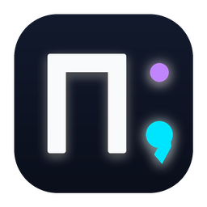

<div align="center">



# Punct (punct_ru)

**Ультра-лёгкий офлайн-инструмент для мгновенного восстановления пунктуации и заглавных букв в русском тексте для Windows.**

[](https://github.com)
[](https://www.rust-lang.org/)
[](https://onnxruntime.ai/)
[](#)
[](#)
[](LICENSE)

</div>

---

## ⚡ О проекте

Часто при быстрой переписке, транскрибации речи или голосовом вводе текст получается "потоком" без точек, запятых и заглавных букв. 

**Punct** работает прямо в фоне Windows на базе компактной квантованной нейросети (INT8), помогая расставлять знаки препинания на лету в **любом** приложении — будь то Telegram, Discord, браузер, Microsoft Word, блокнот или IDE.

---

## 🚀 Как это работает

### Способ 1: На лету (Двойной пробел)
Просто печатайте текст в любом поле ввода без знаков. В конце предложения нажмите **дважды пробел** (`Space` + `Space`):
> `привет как дела что делаешь` + `Space Space`  
> $\rightarrow$ `Привет, как дела, что делаешь?`

### Способ 2: Для любого выделенного фрагмента
Выделите любой написанный текст (мышью или `Ctrl + A`) и нажмите глобальную комбинацию:
> **`Alt + P`**  
> Выделенный текст мгновенно заменится на грамотный вариант.

---

## 💎 Ключевые возможности

* **100% Офлайн и приватность:** Текст никогда не отправляется в облако. Обработка выполняется локально за 10–25 миллисекунд.
* **0% нагрузки на CPU в фоне:** Используются низкоуровневые хуки Win32 (`SetWindowsHookExW` / `RegisterHotKey`) с блокирующими очередями сообщений.
* **Автономный Single-File бинарник:** Модель и токенизатор вшиты в тело `.exe` — никаких внешних DLL и зависимостей.
* **Два режима работы в трее:**
  * **Разговорный (Casual):** Мягкая пунктуация для чатов без навязчивых точек в конце сообщений.
  * **Деловой (Formal):** Строгая академическая пунктуация для писем, статей и документов.
* **Автозапуск с Windows:** Включение/выключение в 1 клик через контекстное меню трея.

---

## 📥 Скачать и запустить

1. Перейдите во вкладку [**Releases**](../../releases/latest).
2. Скачайте архив **`Punct_v1.0.0_Windows_x64.zip`**.
3. Распакуйте в удобное место и запустите `punct.exe`.
4. В трее Windows (возле часов) появится иконка **Punct** — приложение готово к работе!

---

## 🛠️ Сборка из исходников

### Требования
* Windows 10/11 x64
* [Rust & Cargo](https://rustup.rs/) (версия 1.75+)
* MSVC C++ Build Tools

### Сборка
```bash
git clone https://github.com/N3uralCreativity/punct_ru.git
cd punct_ru/app_rust
cargo build --release
```
Собранный исполняемый файл будет находиться в `app_rust/target/release/punct_app.exe`.

---

